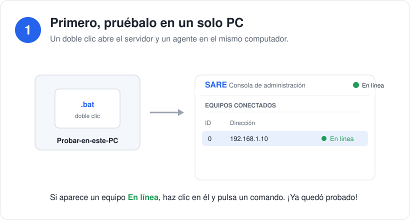
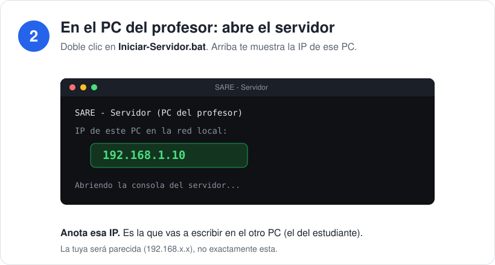
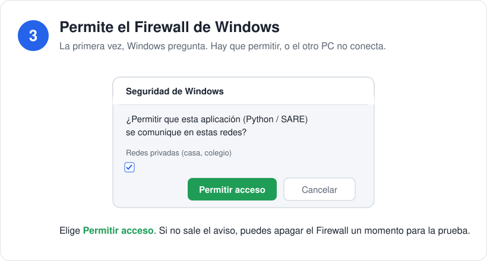
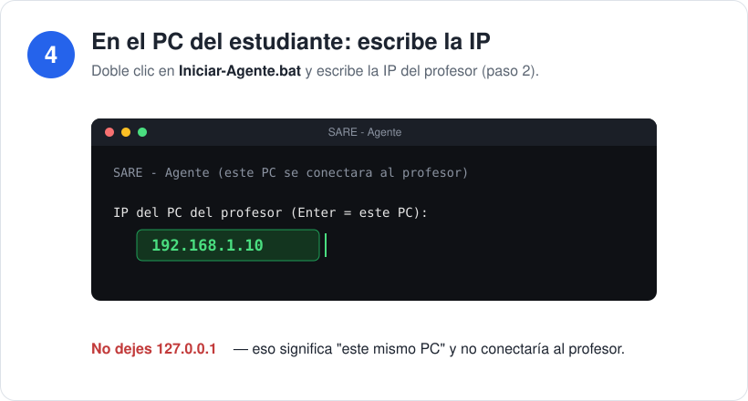
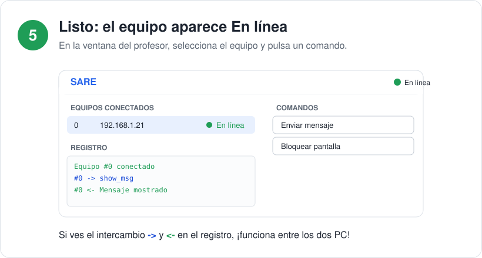

# Guía visual — Cómo probar SARE paso a paso

Guía sencilla para probar SARE entre dos computadores con Windows.
No hay que escribir comandos: todo es con doble clic.

> Los dos PC deben estar en la **misma red** (mismo Wi-Fi o el mismo cable/switch).

---

## Paso 1 · Primero, pruébalo en un solo PC

Doble clic en **`Probar-en-este-PC.bat`**. A los pocos segundos aparece un equipo
**En línea** en la lista. Haz clic en él y pulsa un comando (por ejemplo
*Enviar mensaje*). Si responde, ya quedó probado en un PC.

---

## Paso 2 · En el PC del profesor: abre el servidor

Doble clic en **`Iniciar-Servidor.bat`**. Arriba te muestra la **IP de ese PC**
(algo como `192.168.1.10`). **Anótala**: es la que vas a escribir en el otro PC.

---

## Paso 3 · Permite el Firewall de Windows

La primera vez, Windows pregunta. Elige **Permitir acceso** (red privada).
Si no permites, el otro PC no se podrá conectar.

---

## Paso 4 · En el PC del estudiante: escribe la IP del profesor

Doble clic en **`Iniciar-Agente.bat`**. Cuando pregunte la IP, escribe la del
paso 2 (la del profesor). **No dejes `127.0.0.1`**: eso significa "este mismo PC"
y no conectaría al profesor.

---

## Paso 5 · Listo: el equipo aparece En línea

En la ventana del profesor, el equipo del estudiante aparece **En línea**.
Selecciónalo y envía un comando. Verás el intercambio en el registro.

---

## Si algo no funciona

| Problema | Causa casi siempre | Solución |
|----------|--------------------|----------|
| "Dice conectado pero no aparece" | El agente quedó en `127.0.0.1` | Poner la IP del PC del profesor |
| No conectan entre los dos PC | Firewall de Windows | Permitir acceso en el PC del profesor |
| Tampoco así | No están en la misma red | Conectar ambos al mismo Wi-Fi |

Guía en texto (para reenviar por chat): [../COMO-PROBAR.txt](../COMO-PROBAR.txt)
